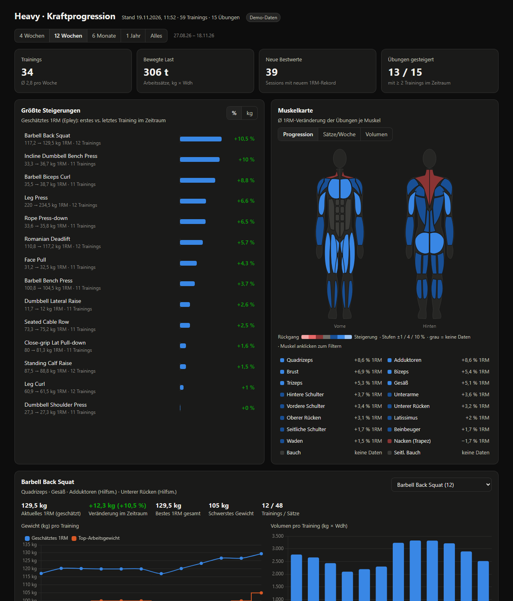

# Heavy

**Auto-Progression und Progressions-Dashboard für Garmin-Krafttraining.**
Was du auf der Uhr stemmst, steht beim nächsten Mal automatisch im Workout. Dazu kommt eine Auswertung mit
Muskelkarte und Diagrammen.

[](https://www.paypal.com/cgi-bin/webscr?cmd=_xclick&business=simeon322%40gmail.com&item_name=Kaffee%20f%C3%BCr%20Heavy&currency_code=EUR)


<sub>Dashboard mit simulierten Demo-Daten (`heavy demo`)</sub>

---

## Das Problem

Krafttraining-Workouts in Garmin Connect sind **starr**. Erhöhst du auf der Uhr (z. B. Fenix 8) während des
Trainings das Gewicht, landet das nur in der aufgezeichneten Aktivität, aber **nicht im Workout**. Beim nächsten
Mal steht wieder das alte Gewicht drin. Außerdem zeigt Garmin Connect kaum, wie du dich pro Übung oder pro
Muskel entwickelst.

## Die Lösung

```
Uhr ──Sync──▶ Garmin Connect ──① Sätze lesen──▶ Heavy
                    ▲                             │ ② Zielgewicht berechnen
                    └──③ Workout aktualisieren ◀──┘ ④ an die Uhr senden
                                                    ⑤ Dashboard erzeugen
```

- **Übernimmt, was du wirklich gemacht hast:** Basis ist immer das Gewicht deiner letzten Arbeitssätze.
  Spontane Erhöhungen auf der Uhr gehen nicht mehr verloren.
- **Doppel-Progression 8–12 Wdh:** Erst steigen die Wiederholungen, bei 12 in allen Sätzen das Gewicht.
  Danach geht es zurück auf 8.
- **Stufen nach Gerät:** Maschinen und Kabel +5 kg, Kurzhanteln +1 kg, Smith-Maschine +2,5 kg, sonst +2,5 kg.
  Alles einstellbar.
- **Nie senken:** Die Vorlage sinkt nur durch einen Deload (−10 % nach 3 Fehlversuchen in Folge), nicht weil du
  einmal leichter trainiert hast.
- **Aufwärmsätze** (unter 60 % des Topgewichts) und Sätze mit 0 Wdh werden ignoriert.
- **Sicher wiederholbar:** Jedes Training wird nur einmal verrechnet. `heavy auto` kann beliebig oft laufen.
- **Testlauf** (`--dry-run`) zeigt jede Änderung, bevor etwas an Garmin geht.
- **Dashboard:**
  - die größten Steigerungen pro Übung (geschätztes 1RM)
  - eine anatomische **Muskelkarte** (Progression, Sätze/Woche, Volumen)
  - Verläufe pro Übung, eine Wochen-Heatmap pro Muskel
  - das Protokoll aller Änderungen an der Uhr
- **Mehrere Personen** mit getrennten Garmin-Konten
- **Läuft auf PC oder Synology-NAS** (Docker)

## Voraussetzungen

- **Python 3.12** oder neuer
- Ein Garmin-Connect-Konto mit **eigenen** Krafttraining-Workouts. Garmin-Coach- und adaptive Pläne lassen sich
  nicht bearbeiten.
- Eine Garmin-Uhr mit Krafttraining-Aufzeichnung. Entwickelt und getestet mit einer Fenix 8.
- Windows (die Befehle unten sind für PowerShell). Der Python-Code selbst läuft auch unter Linux und macOS mit
  `python -m heavy …`.

## Schnellstart

```bash
git clone https://github.com/today12-pixel/heavy.git
```
```bash
cd heavy
```
```bash
pip install -r requirements.txt
```

**Erst ohne Garmin-Konto ausprobieren:** Die Demo simuliert 20 Wochen Training mit derselben Engine:
```bash
.\heavy.cmd demo --open
```

**Mit deinem Konto:**
```bash
.\heavy.cmd login
```
E-Mail, Passwort und ggf. MFA-Code gibst du selbst ein. Gespeichert wird nur ein Token in
`~/.garminconnect-heavy`, **nicht** dein Passwort.

```bash
.\heavy.cmd sync
```
```bash
.\heavy.cmd workouts --details
```
```bash
.\heavy.cmd manage <Workout-ID> <Workout-ID>
```
```bash
.\heavy.cmd progress --dry-run
```
```bash
.\heavy.cmd auto --open
```

Beim ersten Start legt Heavy eine `config.json` mit sinnvollen Standardregeln an. Sie bleibt lokal und wird
nicht ins Repository übernommen.

> In PowerShell ist das `.\` vor `heavy.cmd` Pflicht.

## Befehle

| Befehl | Was er tut |
|---|---|
| `login` | Einmalig bei Garmin anmelden (Token wird gespeichert) |
| `sync [--refresh TAGE]` | Neue Krafttrainings mit allen Sätzen laden. `--refresh` lädt die letzten Tage neu. |
| `workouts [-d]` | Eigene Krafttraining-Workouts mit IDs (und Übungen) auflisten |
| `manage <IDs> / --all`, `unmanage <IDs>` | Festlegen, welche Workouts automatisch mitwachsen |
| `progress [--dry-run]` | Zielgewichte berechnen und in die Workouts schreiben |
| `report [--open]` | Dashboard erzeugen |
| `auto` | `sync` + `progress` + `report` in einem |
| `demo [--open]` | Demo mit simulierten Daten |
| `profile` | Alle Profile (Personen) auflisten |
| `--profil NAME <befehl>` | Befehl für eine weitere Person ausführen |

## Anleitungen

1. [Eine weitere Person hinzufügen](anleitungen/1_zweiten_benutzer_hinzufuegen.md)
2. [Warum Heavy so gebaut ist und wie die Logik funktioniert](anleitungen/2_aufbau_und_logik.md)
3. [Heavy auf einer Synology (Container Manager)](synology/ANLEITUNG.md)

## Automatisch laufen lassen

- **Windows:** `powershell -ExecutionPolicy Bypass -File .\install_task.ps1` richtet eine Aufgabe ein, die alle
  2 Stunden `heavy auto` ausführt. Entfernen geht mit `-Remove`.
- **Synology:** Ein Docker-Container läuft dauerhaft und liefert die Dashboards im Heimnetz aus. Siehe
  [synology/ANLEITUNG.md](synology/ANLEITUNG.md).

## Einstellungen (`config.json`)

| Schlüssel | Bedeutung |
|---|---|
| `managed_workouts` | IDs der Workouts, die angepasst werden (oder `"all"`) |
| `default_rule.mode` | `double` (Doppel-Progression), `carry` (nur letztes Gewicht übernehmen), `off` |
| `default_rule.increment` | Steigerung in kg bei Erfolg |
| `default_rule.rep_range` | Wdh-Bereich, z. B. `[8, 12]` |
| `default_rule.allow_decrease` | `false`: Vorlage nie senken (außer Deload) |
| `default_rule.round_to` | Rundung, z. B. `0.5` |
| `default_rule.deload_after` / `deload_pct` | Fehlversuche bis zum Deload / Deload-Höhe |
| `default_rule.warmup_ratio` | Sätze unter diesem Anteil vom Topgewicht zählen als Aufwärmen |
| `name_rules` | Regeln nach Stichwort im Übungsnamen (`SMITH`, `DUMBBELL`, `CABLE` …), erste passende gewinnt |
| `category_rules` | Regeln pro Garmin-Kategorie, z. B. `"CURL": {"increment": 1.0}` |
| `exercise_rules` | Regeln pro Übung, Schlüssel `KATEGORIE/ÜBUNG` (siehe `workouts -d`) |
| `push_to_device` | Workout nach dem Update an die Uhr senden |
| `hauptprofil` | Name des Hauptprofils auf der Synology (URL `/<name>/`) |

Reihenfolge: `default_rule` → `category_rules` → `name_rules` → `exercise_rules`. Spätere überschreiben frühere.

## Projektaufbau

```
heavy/                 Python-Paket
  progression.py       Rechenregeln (ohne Garmin-Abhängigkeit, getestet)
  workouts.py          Garmin-Workout-JSON lesen und gezielt ändern
  garmin.py            Anmeldung und Sync
  engine.py            Ablauf: Workout holen → rechnen → speichern → an Uhr senden
  db.py                SQLite: Trainings, Sätze, Änderungsprotokoll
  muscles.py           Übung → Muskelgruppen
  report.py            Dashboard-Daten
  templates/           Dashboard (HTML, CSS, JavaScript, SVG-Muskelkarte)
  demo.py              Simulation für die Demo
tests/                 Automatische Tests
synology/              Dockerfile, Compose-Datei, Startskript, Anleitung
anleitungen/           Ausführliche Dokumentation
heavy.cmd              Startskript für Windows
synology_paket.ps1     Baut das Paket für die Synology
install_task.ps1       Windows-Aufgabenplanung
```

## Tests

```bash
python -m unittest tests.test_heavy -v
```

## Datenschutz

Heavy speichert alles **lokal**: Trainings in `data/`, Dashboards in `report/`, weitere Personen in `profile/`,
das Garmin-Token in `~/.garminconnect-heavy`. Daten gehen nur an Garmin, sonst nirgendwohin. Die
`.gitignore` hält persönliche Dateien aus dem Repository heraus. Prüfe trotzdem vor jedem Commit, was du
hochlädst. **Ein Garmin-Token ist so gut wie dein Passwort.**

## Hinweise und Grenzen

- Heavy nutzt die **inoffizielle** Garmin-Connect-Schnittstelle über die Bibliothek
  [`garminconnect`](https://github.com/cyberjunky/python-garminconnect). Garmin kann sie jederzeit ändern. Meist
  hilft dann `pip install -U garminconnect`.
- Die Übungserkennung der Uhr muss stimmen. Falsch erkannte Übungen in Garmin Connect korrigieren und mit
  `sync --refresh 7` neu laden.
- Übungen mit Körpergewicht (0 kg) werden ausgewertet, aber nicht automatisch angepasst.
- Das Docker-Image ist bisher nicht auf einer echten Synology gebaut worden. Rückmeldungen sind willkommen.

## Haftungsausschluss

Heavy ist ein privates Projekt und steht in **keiner Verbindung zu Garmin Ltd.** oder deren
Tochtergesellschaften. „Garmin“, „Garmin Connect“ und „Fenix“ sind Marken von Garmin. Die Nutzung erfolgt auf
eigene Verantwortung. Heavy ändert Workouts in deinem Garmin-Konto, nutze vorher den Testlauf.
Trainingsempfehlungen ersetzen keine fachliche Beratung.

## Unterstützen

Dir hilft Heavy beim Training? Über einen Kaffee freue ich mich:
[**Buy me a coffee (PayPal)**](https://www.paypal.com/cgi-bin/webscr?cmd=_xclick&business=simeon322%40gmail.com&item_name=Kaffee%20f%C3%BCr%20Heavy&currency_code=EUR) ☕

## Lizenz

[MIT](LICENSE)
